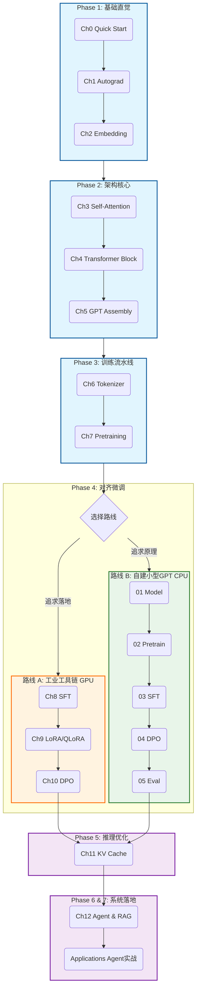

# LLM & Agent 核心技术实战教程

[章节与应用的对应关系](./docs/architecture.md)

## 目录

- [📌 项目定位](#-项目定位)
- [🎯 这门课适合谁](#-这门课适合谁)
- [⚡ 快速入口（Agent First）](#-快速入口agent-first)
- [🧭 学习路线](#-学习路线)
- [📚 章节导览](#-章节导览)
- [🤖 Applications：Agent 实战案例](#-applicationsagent-实战案例)
- [🧩 Bonus：进阶专题](#-bonus进阶专题)
- [🛠 环境配置](#环境配置)
- [🧰 模型与技术栈](#-模型与技术栈)
- [🗂 项目结构](#-项目结构)
- [📄 License](#-license)

---

## 📌 项目定位

这是一套以 **Jupyter Notebook** 为载体的「LLM + Agent」核心技术实战教程：  
**把“黑盒大模型”拆开讲清楚，再把能力落到可运行的 Agent 工程**。

---

## 🎯 这门课适合谁

| 你是谁 | 来这里的典型目标 | 你会带走什么 |
|---|---|---|
| 工程师 / 研发 | 从“会调 API”进阶到“能评估/搭建/落地 LLM & Agent 系统” | 工业级工具链（Transformers/PEFT/TRL） + Agent 工程模板 |
| 学生 / 研究者 | 需要一套能跑通的代码库来建立直觉、验证想法 | 从零实现链路 + 透明的训练/对齐/评测过程 |
| 产品 / 数据 / 运营 | 想获得技术判断力：成本/效果/边界 | 主流技术栈与方案边界、落地模式与取舍 |

### 前置要求

- ✅ **Python 3.10+**（推荐使用 `llmcs` 环境：Python 3.11.15），能运行 Notebook（Jupyter/Lab）和官方 MCP/Langfuse SDK
- ✅ 基本编程能力即可（不要求系统的 DL/数学背景）
- ➕ **推荐 NVIDIA GPU**：SFT/LoRA/DPO 等章节更顺畅（CPU 也可阅读与小规模演示）

---

第一次跑自建 GPT 时，按 02 → 03 → 04 → 05 的顺序运行。02 创建词表和预训练权重，后面每一步都读取上一步的结果。已有 `models/library_handover/` 下的整套权重时，可以直接跑 05。Ch8–10 各自加载基座模型，可独立运行。

## ⚡ 快速入口（Agent First）

| 目标 | 直接跳转 | 你会得到 |
|---|---|---|
| 本地免费跑 Agent（推荐） | [`Applications/PREPARE_OLLAMA.ipynb`](./Applications/PREPARE_OLLAMA.ipynb) → App1 | 本地 LLM 后端连通 + Agent 全流程可跑 |
| 只想看最经典 Agent 模式 | [`App1_ReAct_Agent.ipynb`](./Applications/App1_ReAct_Agent.ipynb) | Thought-Action-Observation 循环 + 工具调用 |
| 想做知识库问答（企业最常见） | [`App2_RAG_System.ipynb`](./Applications/App2_RAG_System.ipynb) | 分块/向量检索/上下文注入的 RAG 工程 |
| 想做“能写代码并执行”的智能体 | [`App3_Code_Agent.ipynb`](./Applications/App3_Code_Agent.ipynb) | 课堂 Python 练习的生成、执行与错误回传 |
| 想做多角色协作 | [`App4_Multi_Agent.ipynb`](./Applications/App4_Multi_Agent.ipynb) | Planner/Coder/Reviewer/Tester 协作框架 |

---

## 🧭 学习路线

<details>
<summary>学习路线图</summary>



</details>

### 两条训练路线

| 维度 | 路线 A · HuggingFace 工具链 | 路线 B · 自建小型 GPT |
|:---|:---|:---|
| **核心价值** | 掌握工业级工具链，快速落地（SFT/LoRA/DPO + Agent） | 拆解训练全链路，建立底层直觉（白盒可控实验台） |
| **技术栈** | `transformers` / `peft` / `trl` | 纯 PyTorch 自实现 |
| **模型规模** | 102M（GPT-2 Chinese）与 494M（Qwen2.5-0.5B） | ~2.7M（RoPE / RMSNorm / SwiGLU） |
| **硬件要求** | **建议 GPU**（尤其 DPO；**QLoRA 需要 CUDA/bitsandbytes**） | **CPU 友好**（可完整跑通） |
| **透明度** | 工具封装（灰盒） | 100% 透明（白盒，可改可复现） |

#### 路线 A 的设备要求

- **Ch8 SFT**：GPT-2 Chinese（102M）— **CPU 可跑但慢**（GPU 更舒适）  
- **Ch9 LoRA**：GPT-2 Chinese（102M）— **CPU 可跑**；**QLoRA 依赖 bitsandbytes，仅 CUDA**  
- **Ch10 DPO**：Qwen2.5-0.5B（494M）— **强烈建议 GPU**（CPU 训练较慢）

#### 推荐组合

两条路线相互独立，可单独完成；也可交叉学习获得更完整视角。  
**推荐节奏：先走路线 A（落地与工具链）→ 再走路线 B（白盒补全与可控对照）。**


---

## 📚 章节导览

### Phase 1：基础直觉（Foundations）

| 章节 | 主题 | Deliverable | Key Ideas |
|---|---|---|---|
| [**Ch0**](./Ch0_Quick_Start/Ch0_Quick_Start.ipynb) | Quick Start | 最小训练闭环（数据→loss→更新） | 训练循环、优化器、指标与可视化 |
| [**Ch1**](./Ch1_Autograd/Ch1_Autograd.ipynb) | Autograd | 手写 Micrograd / 计算图反传 | 计算图、链式法则、`backward()` 本质 |
| [**Ch2**](./Ch2_Embedding/Ch2_Embedding.ipynb) | Embedding | 训练词向量并做相似度/可视化 | 分布式语义、Embedding 检索直觉 |

### Phase 2：架构核心（Architecture）

| 章节 | 主题 | Deliverable | Key Ideas |
|---|---|---|---|
| [**Ch3**](./Ch3_Self_Attention/Ch3_Self_Attention.ipynb) | Self-Attention | Attention 前向 + mask + 权重可视化 | Q/K/V、因果 mask、注意力解释性 |
| [**Ch4**](./Ch4_Transformer_Block/Ch4_Transformer_Block.ipynb) | Transformer Block | 标准 Decoder Block 组装 | Residual、LayerNorm、FFN、dropout |
| [**Ch5**](./Ch5_GPT_Assembly/Ch5_GPT_Assembly.ipynb) | GPT Assembly | 从零组装可推理 GPT | 位置编码、采样（T/top-k/top-p） |

### Phase 3：训练流水线（Training Pipeline）

| 章节 | 主题 | Deliverable | Key Ideas |
|---|---|---|---|
| [**Ch6**](./Ch6_Tokenizer/Ch6_Tokenizer.ipynb) | Tokenizer | BPE 训练/编码/解码（含 `tiktoken`） | 词表构建、token 粒度取舍、稳定性 |
| [**Ch7**](./Ch7_Pretraining/Ch7_Pretraining.ipynb) | Pretraining | 预训练小型 GPT-2 风格基座（演示规模） | Dataset/DataLoader、Next-token、checkpoint |

### Phase 4：对齐与微调（Alignment）— 双路线

#### 路线 A：工业工具链（Transformers / PEFT / TRL）

| 章节 | 主题 | 示例基座模型 | Deliverable | Key Ideas |
|---|---|---|---|---|
| [**Ch8**](./Ch8_SFT/Ch8_SFT.ipynb) | SFT 指令微调 | `uer/gpt2-chinese-cluecorpussmall` | 指令数据格式化 + SFT 训练与对比 | Chat 模板、loss masking、对话化 |
| [**Ch9**](./Ch9_LoRA_Quantization/Ch9_LoRA_Quantization.ipynb) | LoRA /（可选）QLoRA | `uer/gpt2-chinese-cluecorpussmall` | 低资源微调 | PEFT LoRA、量化思路、显存/速度 |
| [**Ch10**](./Ch10_DPO/Ch10_DPO.ipynb) | DPO 偏好对齐 | `Qwen/Qwen2.5-0.5B-Instruct` | 偏好对齐训练 + 效果对比 | preference pair、DPO loss、TRL 实战 |

#### 路线 B：自建小型 GPT（全链路自实现）

| 章节 | 主题 | Deliverable | Key Ideas |
|---|---|---|---|
| [**01**](./Custom_GPT_Training/01_Model_Assembly.ipynb) | Model Assembly | 自建 GPT（现代组件）可跑通前向 | RoPE、RMSNorm、SwiGLU |
| [**02**](./Custom_GPT_Training/02_Pretraining.ipynb) | Pretraining | 自建模型的预训练闭环 | warmup+cosine、grad clip、日志与保存 |
| [**03**](./Custom_GPT_Training/03_SFT_Training.ipynb) | SFT Training | 自建模型的指令微调 | Chat 格式化、loss masking、自测集 |
| [**04**](./Custom_GPT_Training/04_DPO_Training.ipynb) | DPO Training | DPO 核心计算（自实现） | preference loss、reward margin 监控 |
| [**05**](./Custom_GPT_Training/05_Evaluation.ipynb) | Evaluation | Base/SFT/DPO 的评测对比 | 固定文本 PPL、交接内容与动作顺序的逐类核对 |

### Phase 5：推理优化（Inference）

| 章节 | 主题 | Deliverable | Key Ideas |
|---|---|---|---|
| [**Ch11**](./Ch11_KV_Cache/Ch11_KV_Cache.ipynb) | KV Cache | 读懂并能解释推理加速的核心机制 | prefill/decode、KV 形状、显存/吞吐权衡 |

### Phase 6：系统落地（System）

| 章节 | 主题 | Deliverable | Key Ideas |
|---|---|---|---|
| [**Ch12**](./Ch12_Agent_RAG/Ch12_Agent_RAG.ipynb) | Agent & RAG | “能推理/能调用工具/能检索”的 Agent 原型 | ReAct、Tool Use、RAG pipeline |

Multi-Agent、MCP、Skills 和 LLMOps 的讲解和代码都在 [Applications](#-applicationsagent-实战案例)。

---

## 🤖 Applications：Agent 实战案例

### 统一工程组件（utils/）

- **LLM 后端抽象**：`utils/llm_backend.py`（OpenAI / Ollama / HuggingFace / vLLM）
- **Embedding 抽象**：`utils/embedding_backend.py`（SentenceTransformers / OpenAI / HuggingFace）
- **Multi-Agent 调度器**：`utils/multi_agent.py`（BaseAgent / Hierarchical / Debate / Handoff / CircuitBreaker）
- **MCP 协议封装**：`utils/mcp_helpers.py`（EduMCPServer/Client + tool_from_function，含真 stdio JSON-RPC subprocess）
- **可观测性**：`utils/observability.py`（@observe + Langfuse 自动检测 + 自动 token 估算）
- **Skills 解析**：`utils/skills_helpers.py`（discover / match / progressive load）

### 应用清单

| 应用 | 主题 | 关键能力 / 涵盖技术 |
|---|---|---|
| [**PREPARE**](./Applications/PREPARE_OLLAMA.ipynb) | Ollama Setup | 本地模型下载 / 连通性检查 |
| [**App0**](./Applications/App0_Setup_Check.ipynb) | 环境自检 | Python、utils、模型配置、依赖与数据文件 + `verify_environment()` |
| [**App1**](./Applications/App1_ReAct_Agent.ipynb) | ReAct Agent | 推理-行动循环 + 工具选择 + observability + CircuitBreaker + `verify_app1()` |
| [**App2**](./Applications/App2_RAG_System.ipynb) | RAG System | 分块/检索/重排/注入 + Self-RAG / CRAG / Hybrid (Vec+BM25+RRF) / Cross-Encoder Reranker / MMR + `verify_app2()` |
| [**App3**](./Applications/App3_Code_Agent.ipynb) | Code Agent | 代码生成 + 受限的课堂执行器 + MCP-style tool 包装 + 权限层 + `verify_app3()` |
| [**App4**](./Applications/App4_Multi_Agent.ipynb) | Multi-Agent | 角色分工 + Hierarchical / Debate / Handoff + CircuitBreaker + `verify_app4()` |
| [**App5**](./Applications/App5_MCP_Server.ipynb) | MCP Server | 真 stdio JSON-RPC subprocess + Tools / Resources / Prompts + 权限层（配套 [`Applications/mcp_server_demo/`](./Applications/mcp_server_demo/)） |
| [**App6**](./Applications/App6_Skills_Pack.ipynb) | Anthropic Skills | 写 SKILL.md + helper.py + progressive disclosure + Skills × MCP 集成（配套 [`Applications/skills_demo/`](./Applications/skills_demo/) 三个完整范例） |
| [**App7**](./Applications/App7_LLMOps.ipynb) | LLMOps 可观测性 | @observe + 嵌套 span tree + token 估算 + Langfuse 集成 |
| [**App8**](./Applications/App8_Production_Capstone.ipynb) | Production Capstone | Multi-Agent + MCP + Agentic RAG + LLMOps 综合集成（配套 [`Applications/skills_demo/capstone_assistant/`](./Applications/skills_demo/capstone_assistant/) + [`data/eval_dataset.jsonl`](./data/eval_dataset.jsonl)） |

> 路径建议：先 `PREPARE` → `App0` 自检；想最快跑通从 `App1` 开始；想通览全部主题就 App1 → App8 顺过去。

---

## 🧩 Bonus：进阶专题

| 章节 | 主题 | 你会得到 |
|---|---|---|
| [**Bonus A**](./Bonus_A_RLHF/Bonus_A_RLHF.ipynb) | RLHF 全景 | Reward Model / PPO 思路，理解 RLHF vs DPO 的关系 |
| [**Bonus B**](./Bonus_B_Evaluation/Bonus_B_Evaluation.ipynb) | 评测方法论 | PPL、下游任务、LLM-as-Judge 的评测框架 |

---

## 环境配置

### 1) 克隆仓库

```bash
git clone https://github.com/Greebbie/LLM-Agent-Core_Concept_Code.git
cd LLM-Agent-Core_Concept_Code
```

### 2) 创建虚拟环境（推荐）
> 推荐使用 Conda；当前课程主环境为 `llmcs`，Python 3.11.15。

```bash
conda create -n llmcs python=3.11 -y
conda activate llmcs
```

如不使用 Conda，也可以用 venv：

```bash
python -m venv venv

# macOS / Linux
source venv/bin/activate

# Windows (PowerShell)
venv\Scripts\Activate.ps1
```


### 3) 先安装 PyTorch（按设备选择其一）

使用 Python 3.11 和 CUDA 12.8 的环境可按以下命令安装 PyTorch：

```bash
python -m pip install torch --index-url https://download.pytorch.org/whl/cu128
```

只用 CPU 时运行 `python -m pip install torch --index-url https://download.pytorch.org/whl/cpu`。其他显卡环境可查询 [PyTorch 安装选择器](https://pytorch.org/get-started/locally/)。

### 4) 安装项目依赖

```bash
pip install -r requirements.txt
```

### 5) 启动 Notebook

```bash
python -m ipykernel install --user --name llmcs --display-name "Python (llmcs)"
jupyter lab
# or: jupyter notebook
```

### 6) Agent 后端配置

**Ollama（本地运行）**

保留运行 JupyterLab 的终端，另开一个终端执行 `ollama list`。能列出模型就说明服务已经启动；如果连不上服务，先打开 Ollama 应用。列表中缺少 `qwen3:4b` 时运行：

```bash
ollama pull qwen3:4b
```

在 JupyterLab 中打开 [App1](./Applications/App1_ReAct_Agent.ipynb)，选择 `Python (llmcs)`，从第一格运行到值班表实验。两次问的都是摄影展取票地点；改表前工具返回「西厅」，改表后返回「北楼」。安装步骤见 [Ollama 准备指南](./Applications/PREPARE_OLLAMA.ipynb)。

**OpenAI**

```bash
# macOS/Linux
export OPENAI_API_KEY="<your_openai_api_key>"

# Windows (PowerShell)
setx OPENAI_API_KEY "<your_openai_api_key>"
```

**DashScope（阿里云通义，国内默认）**

```bash
# macOS/Linux
export DASHSCOPE_API_KEY="<your_dashscope_api_key>"

# Windows (PowerShell)
setx DASHSCOPE_API_KEY "<your_dashscope_api_key>"
```

模型名走 env var：默认 `LLM_MODEL=qwen-plus-2025-01-25`、`EMBEDDING_MODEL=text-embedding-v3`，不用改；如果你想走最新别名，再把 `LLM_MODEL` 改成 `qwen-plus`，notebook 不动。

---

## 🧰 模型与技术栈

本教程在不同阶段切换模型规模，以兼顾学习效率与计算资源。

| 模块 | 示例模型 | 规模/说明 |
|---|---|---|
| Pretraining（主线演示） | GPT-2 small 风格（见 Ch7） | 约 150 万参数，从头训练 |
| SFT / LoRA（路线 A） | `uer/gpt2-chinese-cluecorpussmall` | 中文 GPT-2，适合指令微调演示 |
| DPO（路线 A） | `Qwen/Qwen2.5-0.5B-Instruct` | 比较展馆问答中的地点和回复格式 |
| 自建全链路（路线 B） | `Custom_GPT_Training/custom_gpt.py` | 约 2.7M，现代组件（RoPE/RMSNorm/SwiGLU） |
| Agent 应用 | Ollama 本地模型（如 Qwen2.5/Llama3 等） | 本地推理后端，可替换到 OpenAI/HF/vLLM |

---

## 🗂 项目结构

```
LLM-Agent-Core_Concept_Code/
├── Ch0_Quick_Start/ … Ch12_Agent_RAG/    # 主线 13 章（Phase 1-6）
├── Custom_GPT_Training/                   # 路线 B：自建 GPT 全链路
│   ├── custom_gpt.py
│   ├── 01_Model_Assembly.ipynb
│   ├── 02_Pretraining.ipynb
│   ├── 03_SFT_Training.ipynb
│   ├── 04_DPO_Training.ipynb
│   └── 05_Evaluation.ipynb
├── Applications/                          # Agent 实战与系统集成
│   ├── PREPARE_OLLAMA.ipynb
│   ├── App0_Setup_Check.ipynb
│   ├── App1_ReAct_Agent.ipynb
│   ├── App2_RAG_System.ipynb
│   ├── App3_Code_Agent.ipynb
│   ├── App4_Multi_Agent.ipynb
│   ├── App5_MCP_Server.ipynb              # 真 stdio JSON-RPC + 权限层
│   ├── App6_Skills_Pack.ipynb             # SKILL.md + progressive disclosure
│   ├── App7_LLMOps.ipynb                  # @observe + Langfuse trace
│   ├── App8_Production_Capstone.ipynb     # Multi-Agent + MCP + RAG + LLMOps 合体
│   ├── mcp_server_demo/                   # 100 行 stdio JSON-RPC server starter（App5 配套）
│   └── skills_demo/                       # 3 个完整 Skill 范例（App6/App8 配套）
├── Bonus_A_RLHF/                          # RLHF 全景
├── Bonus_B_Evaluation/                    # 评测方法论
├── utils/                                 # 共享工程组件
│   ├── llm_backend.py / embedding_backend.py / config.py
│   ├── multi_agent.py / mcp_helpers.py
│   └── observability.py / skills_helpers.py
├── data/                                  # 训练 / 评测数据
│   ├── pretrain_corpus_zh.txt             # 6 MB 中文语料（Ch7 / Custom_02 推荐）
│   ├── eval_zh_extended.jsonl             # 120 题扩展评估集（App8 配套评测脚本）
│   ├── eval_dataset.jsonl                 # Capstone 评测集（App8 配套）
│   ├── custom_sft_*.jsonl / custom_dpo_*.jsonl    # 自建 GPT 路线 B 数据
│   ├── gpt2_sft_*.jsonl                   # GPT-2 路线 A 数据
│   ├── _archive/                          # 归档：未被当前 notebook 引用
│   └── README.md
├── tools/                                 # 维护脚本（utils + skills_demo / mcp_server_demo 同步器）
├── docs/                                  # 架构图等参考文档
├── models/                                # 训练产出 checkpoint（运行时生成）
├── requirements.txt
└── README.md
```

> **数据说明**：`data/pretrain_corpus_zh.txt` 与 `data/eval_zh_extended.jsonl` 已随仓库提供，分别用于 Ch7 / Custom_02 的预训练演示和 Agent 的扩展评测。详见 [`data/README.md`](./data/README.md)。

---

## 📄 License

MIT License
